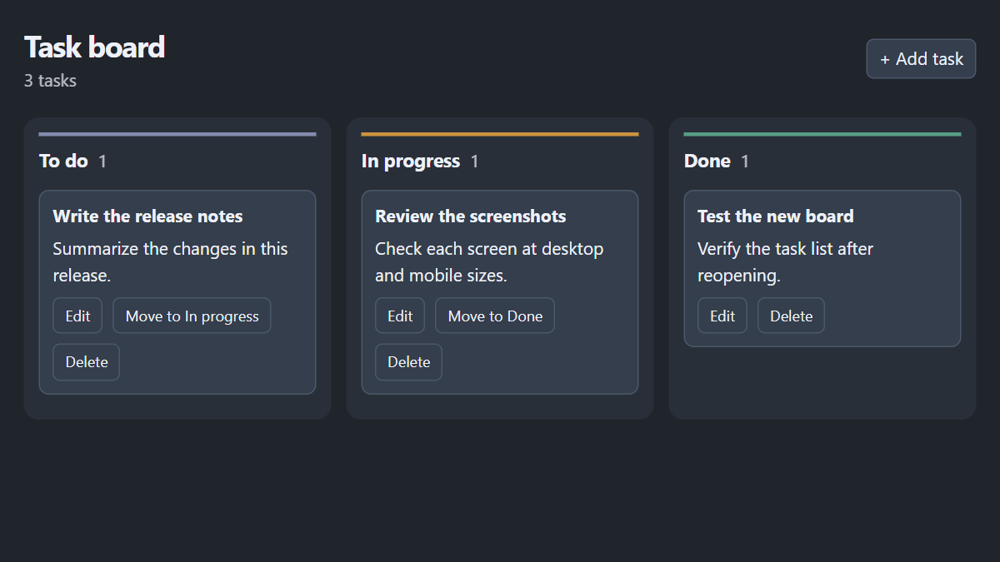
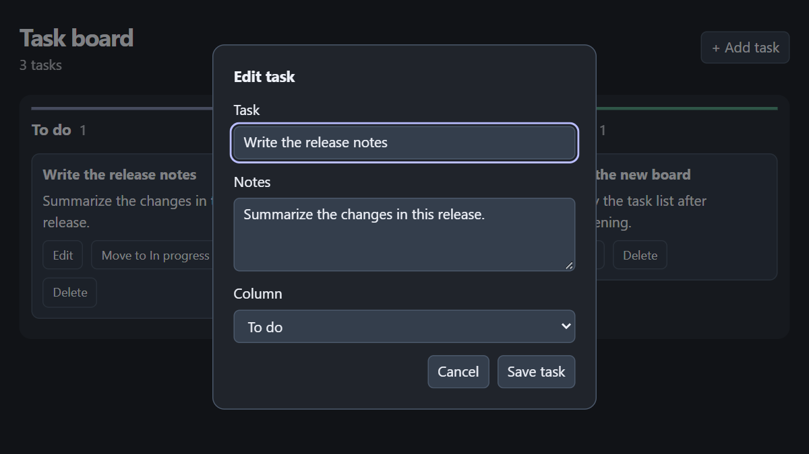

# Kanban mini app




The demo’s [catalog listing](../../public/mini-app-listings/kanban/listing.json) pairs these screenshots with supported workflows, requirements and an example agent request.

A standalone Nextbrowser Mini Apps v2 example. The UI and six native WebMCP tools share the same operations. Agents can read the board, get task details, create and edit tasks, move them to any column and confirm a deletion. Each board is private to the installation and account on this device.

Run `npm run build` in this directory using Node.js 22. The build has no npm dependencies. In Nextbrowser, open **Extensions → Mini Apps → Install from file**, select `kanban.nbmini.json` and grant access to the app's own storage.

To make your own app, change the metadata and tool names in `manifest.json`. Edit `index.html`, `board.css` and `board.js`. The builder inlines the assets into a portable package. Declare each action and register it in the entry document. [v2 authoring guide](../../docs/mini-apps.md) · [Standalone project](https://github.com/0nliner/kanban-mini-app)

The bundled catalog version is reproducible from the desktop repository root with:

```sh
node examples/kanban-mini-app/build.mjs electron/mini-apps/catalog/kanban.nbmini.json
```

For an end-to-end check, build the desktop renderer with `npm run build`, set `NEXTCTL_BIN` to the path of an installed Nextbrowser CLI executable, and run `node scripts/test-mini-apps.mjs` from the desktop repository root. The test uses a temporary account and a local scripted model provider. It checks package validation, all six actions through the built-in agent, visible UI updates, stale document handles and workspace isolation.
